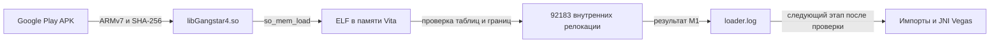

# Исходные данные для порта

Реализован экспериментальный runtime 00.05; M1, конструкторы и JNI проверены
на Vita. Первый завершённый кадр ещё не подтверждён. Исторические этапы ниже
описывают состояние на момент каждого запуска.
Наблюдения получены из локального
Google Play APK и OBB 12 октября 2026 года. SHA-256 и размеры бинарников находятся в
`tools/game_profile.py`, полная опись распаковки в `refs/android/manifest.json`.

## Нативные библиотеки

| ARMv7-библиотека | Размер, байт | Уникальные именованные UND-символы | JNI-экспорты, включая JNI_OnLoad |
| --- | ---: | ---: | ---: |
| libGangstar4.so | 39 300 800 | 392 | 103 |
| libgenerator.so | 447 860 | 83 | 2 |

Обе библиотеки: ELF32 little-endian ARM EABI5, ET_DYN. В APK также есть x86,
но для Vita следует исследовать `apk/lib/armeabi-v7a/`.

`libGangstar4.so` требует `libGLESv2.so`, `liblog.so`, `libc.so`, `libm.so`,
`libdl.so`, `libandroid.so`, `libOpenSLES.so`, `libEGL.so`, `libstdc++.so`.
Его SONAME отличается от имени файла: `libAndroid.so`.
`libgenerator.so` требует `libdl.so`, `libc.so`, `libm.so`, `libstdc++.so`;
экспортирует JNI-методы `HDIDFV_getNHDIDFV` и `HDIDFV_getNHDIDFVVersion`.
Необходимость исполнения этой библиотеки на Vita пока не установлена.

Источники: `refs/android/analysis/<библиотека>.elf.txt`, `.symbols.txt`,
`.imports.txt`, `.jni.txt`, `.relocations.txt`. Для повторного получения отчётов:

```sh
READELF=../.tools/vitasdk/bin/arm-vita-eabi-readelf
SO=refs/android/apk/lib/armeabi-v7a/libGangstar4.so
"$READELF" -h -l -d -A "$SO"
"$READELF" --dyn-syms --wide "$SO"
"$READELF" -r --wide "$SO"
```

## Android и данные

Читаемый манифест: `refs/android/decoded/AndroidManifest.xml`.
Версия и SDK: `refs/android/decoded/apktool.yml`: `1.7.0g`, `17026`,
minSdkVersion `9`, targetSdkVersion `21`.
Манифест объявляет `.Game` как MAIN/LAUNCHER activity и OpenGL ES 2.0.

Стартовые точки для восстановления JNI lifecycle:

- `refs/android/decoded/smali/com/gameloft/android/ANMP/GloftGGHM/Game.smali`:
  activity, вызовы nativeInit и GL2JNILib.init.
- В том же каталоге `GL2JNILib.smali`: сигнатуры setPaths, init, initGL,
  resize, step, pause, resume, destroy и ввода.
- `GL2JNIView$Renderer.smali` и `GameRenderer.smali`: взаимодействие с рендером.
- `installer/`: Java-часть подготовки данных.

Часть порядка старта восстановлена ниже; требования native-кода ещё исследуются.
Наличие названий методов не доказывает совместимость с JNI bridge Rio.
Apktool 3.0.2 завершил разбор основного APK без пропуска классов;
статус и лог находятся в `refs/android/analysis/`. MOD APK отличается по DEX
и основной ARMv7-библиотеке; его разбор содержит ошибки усечённых инструкций
и сохранён в `refs/mod/android/`.

Основной OBB содержит 5830 записей ZIP, patch содержит 2. Кэш включает
вложенные ZIP с геометрией, ресурсами, меню, gamedata и raw_data.
Распакованные main/patch и вложенные архивы доступны в `refs/android/cache/`.
Формат отличается от proprietary OBB, который обрабатывает prepare_data.py Rio.

## Дальнейшая реализация

1. Сопоставить импорты и релокации с загрузчиком Rio/MC2; определить конкретные
   недостающие Android ABI, EGL, GLES, аудио и файловые функции.
2. Восстановить JNI startup и пути к ресурсам по Vegas, затем зафиксировать
   подходящие ревизии загрузчика и vitaGL. Адреса патчей Rio нельзя переносить
   на другой ELF без анализа.
3. Проверить диагностический VPK M1 на физической Vita: профиль, отображение ELF,
   внутренние релокации и логирование. Импорты на этом этапе не связываются.
4. После подтверждения старта добавить кадр, ввод, звук и измерение памяти;
   подготовку `ux0:data/gangstarvegas/` согласовать с фактическим файловым bridge.

Сборка M1 использует `/Volumes/USB/persanal/psvita/.vitasdk-softfp`.
Наличие собранного VPK не доказывает запуск на Vita.

## Перенос с Rio: исследование 13 октября 2026

Rio изучен на ревизии `d3386b2`, MC2 loader на `db3fcfcba7aecedb91236194842d65042fb6fe5a`.
Первый этап использует только so_util и SHA-256, затем записывает результаты
отображения и внутренних релокаций. VitaGL, JNI, конструкторы и игровые патчи
подключаются после проверки этого этапа на Vita.



Профиль: 44230 символов, 92602 релокации, 392 импортируемых символа,
419 релокаций импортов, 103 JNI-экспорта, 540 конструкторов.
В MC2 найдены имена 366 импортов; 26 отсутствуют. С дополнительными обёртками
Rio покрываются имена 374, остаются 18. Это сравнение исходных таблиц, а не
доказательство правильных адресов или ABI. Точный список выводит
`tools/audit_loader_baseline.py`.

Отличия старта Vegas, наблюдаемые в `refs/android/decoded/smali/`:
`GL2JNILib.setupPaths()` пуст (`GL2JNILib.smali:508`), а ELF-экспорты
`initGL` и `setPaths` содержат только `bx lr`. В конструкторе Renderer вызывается
`GameRenderer.nativeInit(IIILjava/lang/String;)V`; activity вызывает
`Game.nativeInit()` и `InitNativeAssetManager`. Источники: пакет
`com/gameloft/android/ANMP/GloftGGHM`, `GL2JNIView$Renderer.smali:118`,
`Game.smali:9475` и `Game.smali:9607`. `Game.GetObbPath()` и
`GLUtils.SUtils.GetApkPath()` требуют полного APK и оригинальных имён OBB.
JNI bootstrap и installer gates Rio не подходят без дальнейшего анализа.

Порядок работы: [x] профиль и аудит, [x] сборка M1, [ ] лог M1 с физической Vita,
[ ] ABI недостающих импортов, [ ] JNI/ресурсы Vegas, [ ] первый кадр.
Изменения ведутся в main; каждый подтверждённый этап фиксируется отдельным коммитом.

M1 собран 13 октября 2026: `GSGV00001`, версия `00.01`, SFO `ATTRIBUTE2=12`.
Сборка завершена с `-Wall -Wextra -Werror`, целостность ZIP VPK и профиль данных
проверены. SHA-256 VPK:
`79cb569b228d28df796df6f6190a4892dee67d133de928476485af54a1cb31da`.
C SHA-256 совпадает с Python hashlib для пустого ввода, `abc`, границ блока и
полного `libGangstar4.so`. Независимое ревью не обнаружило блокирующих ошибок
в диагностическом пути M1.

Первый тест 00.01: VPK установлен пользователем на Vita, eboot.bin и param.sfo
прочитаны после перезапуска и совпали с пакетом. Пользователь сообщил зависание
между приложением и меню. `loader.log` отсутствует, вход в main не подтверждён.
По этим данным нельзя установить причину зависания или обвинить загрузку ELF.

В 00.02 добавлены отсутствовавшие icon0/pic0 и LiveArea bg0/startup/template.xml
с фоном и прозрачным логотипом Vegas, предоставленными владельцем. Обычный запуск проверяет только старт приложения,
записывает свободное место ux0 и завершается через 3 секунды без загрузки ELF.
Для текущей диагностики heap уменьшен с заимствованных у Rio 224 до 64 MiB:
исходный ELF и массивы аудита требуют менее 40 MB, отображённые сегменты и
временная копия выделяются отдельно через kernel blocks. Это уменьшение
резервирования памяти, а не установленная причина первого зависания.
M1 включается непрерывным удержанием L+R в течение секунды в эти первые 3 секунды. Полный режим подготовки Vita
копирует проверенный game.apk и оба исходных ZIP OBB; файловый/JNI bridge будет
использовать их на следующем этапе. Лог успешного запуска и M1 всё ещё ожидаются.

Итоговая сборка 00.02 после уменьшения логотипа стартовой плитки вдвое:
SHA-256 VPK `de7fd2476aaa54c0f00febcc7dfe7cee14a5bb7a4589144ab33111e1919b1ad7`. ZIP содержит ровно семь ожидаемых файлов,
включённые ресурсы совпадают с исходными PNG/XML. Полный набор данных
подготовлен: пять файлов, 2 243 304 528 байт, хэши после копирования проверены.
Новое приложение пока не установлено: FTP вернул `550 Could not allocate memory`
при передаче и затем перестал выдавать приветствие. VitaCompanion 1.06 отвечает
на команды. Это сбой передачи до запуска нового пакета, не доказательство
ошибки нового загрузчика.

Проверка исчезнувшего пузыря: прочитана локальная копия app.db, integrity_check=ok.
Запись GSGV00001 присутствует в tbl_appinfo_icon и размещена во вложенной папке;
владелец визуально подтвердил наличие Vegas в этой папке. Удаления приложения
из базы не произошло. icon0.png, pic0.png и livearea/contents/template.xml
отсутствуют как в ux0:app/GSGV00001/sce_sys, так и по путям ur0:appmeta/GSGV00001,
на которые указывает база. Повторная установка 00.01 не добавляет отсутствующие
в старом VPK ресурсы. Метаданные консоли не изменялись. Передача новых файлов
остановлена по указанию владельца до возобновления; 00.02 ещё не установлен.

## Проверка установленного 00.02 на Vita

13 октября владелец установил переданный 00.02 и запустил его без L+R.
Все семь файлов в ux0:app/GSGV00001 побайтно совпали с VPK SHA-256
`de7fd2476aaa54c0f00febcc7dfe7cee14a5bb7a4589144ab33111e1919b1ad7`.
В ur0:appmeta/GSGV00001 появились icon0.png и livearea/contents/template.xml;
оба прочитаны и совпали с пакетом. Доказательства сохранены локально в
`debug/runs/m1-first/installed-00.02.json` и `startup-00.02.log` (вне Git).

Фактический лог:

```text
[1173083] INFO: Gangstar Vegas Vita 00.02: startup probe
[1173084] INFO: ux0 free bytes=323757015040
[1176116] SUCCESS: startup probe complete; ELF not loaded
```

Это подтверждает вход в main и штатное завершение probe через 3,033 секунды.
Загрузка ELF, внутренние релокации M1 и запуск игры этим тестом не проверялись.
Передача возобновлена владельцем; полный APK/OBB сейчас переносится с проверкой
SHA-256 чтением обратно. На момент этого этапа перенос кэша ещё не завершён.

## Иконка бабла 00.03 и ручной перенос данных

По предоставленному владельцем квадратному портрету подготовлен icon0.png:
128×128, 8-bit indexed PNG, без обрезки. Уменьшенная картинка проверена визуально.
Фон LiveArea и прозрачный логотип кнопки запуска совпадают с пакетом 00.02.
Диагностическое поведение сохранено; версия пакета и строки старта — 00.03.
Сборка с `-Wall -Wextra -Werror` успешна, ZIP содержит семь ожидаемых файлов,
SFO подтверждает GSGV00001, APP_VER 00.03, ATTRIBUTE2=12.
SHA-256 `dist/gangstarvegas-vita-00.03.vpk`:
`96a21cdc1a91d53c40aeba235d9fe687059804db66bca681940ca932c3e3ec1c`.
Пакет 00.03 передан в `ux0:data/gangstarvegas-vita-00.03.vpk` после повторного
включения FTP владельцем. Все 486 556 байт прочитаны обратно; SHA-256 совпал
с локальным пакетом. Доказательство: `debug/runs/m1-first/vpk-00.03-transfer.json`
(вне Git). Установка через VitaShell и проверка установленного 00.03 ещё ожидаются.

FTP-процесс завершился при записи временного main OBB с BrokenPipeError;
отсутствие процесса проверено. По указанию владельца передача не возобновляется.
Две библиотеки и game.apk ранее проверены чтением обратно. Оба полных OBB
и новый manifest.json на Vita пока не подтверждены. Для ручного переноса нужно
скопировать содержимое `dist/gangstarvegas-data-full/` в `data/gangstarvegas/`
на карте ux0 через картридер или USB. Файл с окончанием `.obb.upload`, если остался,
является незавершённой временной копией; он не заменяет оригинальный `.obb`.

Наличие APK в наборе объясняется нативным `ocZ::OpenAPK`: вызов
GameUtils_GetApkPath по адресу 0x4806d4, затем zip_open по 0x4806e4.
Java callback GLUtils/SUtils.GetApkPath возвращает ApplicationInfo.sourceDir
(`refs/android/decoded/smali/com/gameloft/android/ANMP/GloftGGHM/GLUtils/SUtils.smali:237`).
APK сохраняется как контейнер ресурсов, Android-код на Vita не исполняется.
Bridge APK/AAsset ещё предстоит реализовать; нынешний M1 его не использует.

## Проверка установленного 00.03 на Vita

13 октября владелец установил 00.03. Семь файлов приложения прочитаны через FTP
и побайтно совпали с проверенным VPK; icon0.png в ur0:appmeta/GSGV00001
также совпал с новым портретом. Результат:
`debug/runs/m1-first/installed-00.03.json` (вне Git).

```text
[671892] INFO: Gangstar Vegas Vita 00.03: startup probe
[671893] INFO: ux0 free bytes=146086035456
[674923] SUCCESS: startup probe complete; ELF not loaded
```

Старт и штатный выход 00.03 подтверждены; M1 этим запуском не проверялся.
Все пять игровых файлов, включая оба оригинальных OBB, имеют ожидаемые размеры
на Vita. Полный SHA-256 OBB после ручного переноса пока не проверен.
Оставшийся старый manifest.json содержал только две библиотеки. Он сохранён
в manifest.m1-00.01.json, после чего полный манифест записан и проверен чтением
обратно. Файлы игры при этой операции не изменялись.

Две попытки M1 через синтетические L+R VitaCompanion 1.06 дали ответы
Input pressed, но свежие логи показали только обычный startup probe.
Во второй попытке кнопки нажаты до launch и удерживались восемь секунд;
обе кнопки отпущены после каждой попытки. Причина отсутствия chord в приложении
не установлена. Для проверки M1 владельцу передан шаг с физическим удержанием
L+R; лог M1 и исполнение игры пока не подтверждены.

## Автоматический M1 и прямое обновление 00.04

По указанию владельца условие L+R и трёхсекундное ожидание удалены.
Каждый запуск 00.04 сразу проверяет kubridge, SHA-256 библиотеки, отображение ELF
и внутренние релокации. Неиспользуемая зависимость SceCtrl удалена.
Сборка с `-Wall -Wextra -Werror` завершилась успешно.

Сверены текущие соседние порты: Rio `a82e453` выполняет preflight и
elf_diagnostics_run из main, Miami `b4c14a8` вызывает soloader_init_all из main.
Оба начинают загрузку без комбинации кнопок. Rio scripts/deploy_to_vita.sh
обновляет eboot.bin установленного приложения напрямую; этот способ выбран
для дальнейшей работы с Vegas по прямому указанию владельца.

Новый `eboot.bin` передан прямо в `ux0:app/GSGV00001/eboot.bin` и прочитан обратно.
Размер: 49 064 байта; SHA-256:
`c832a1bdd8ed03521fa8dbd38d7fbc5f27db41486170235e918be8d735a2aa20`.
Предыдущий файл 00.03 сохранён рядом как `eboot.00.03.644d8d7ab63e.bin`
и локально в debug/runs/m1-first; его SHA-256 также проверен.
SFO установленного приложения остаётся 00.03, версия runtime в новом коде 00.04.
Передача VPK и переустановка для этого обновления не выполнялись.
Доказательство: `debug/runs/m1-first/direct-deploy-00.04.json` (вне Git).

VitaCompanion принял launch, но прочитанный loader.log пока относится к 00.03.
Попытка повторного rename eboot.bin после launch отклонена FTP; проверено, что
на месте остались новый исполняемый файл и неизменённая резервная копия.
Запуск нового runtime и M1 ещё не подтверждены. Следующий шаг — обычный запуск
Vegas с бабла и чтение нового loader.log, без удержания кнопок.

## Подтверждённый M1 runtime 00.04

Свежий loader.log прочитан с Vita после обычного запуска установленного
исполняемого файла 00.04. Доказательство сохранено вне Git:
`debug/runs/m1-first/current-before-runtime.log`.

```text
[1467934] INFO: Gangstar Vegas Vita 00.04: automatic ELF diagnostic M1
[1476540] SUCCESS: exact game binary verified: 39300800 bytes
[1477286] SUCCESS: ELF mapped: text=0x98000000 size=27043444 data_segments=1
[1481759] SUCCESS: M1 complete: internal_relocations=92183 imports_unbound=419 constructors_not_run=540
[1481766] INFO: diagnostic result=0; game execution is pending import and JNI support
```

M1 на физической Vita подтверждён. Следующий этап — связывание импортов,
ресурсный bridge, конструкторы и JNI Vegas. Исполнение игры ещё не проверено.

### Loose APK resources for the runtime

`prepare_data.py --mode vita` now extracts the original APK's `assets/` and
`res/` alongside the APK and OBBs. Existing matching files are reused; a
different existing file stops preparation without overwriting it. This supplies
the real files read by AAssetManager and the Java resource callbacks.

On the Vita, all 379 resource files (6,486,015 bytes) were transferred to
`ux0:data/gangstarvegas/` and their SHA-256 hashes verified by FTP read-back.
The existing APK, libraries and OBBs were retained. Evidence:
`debug/runs/runtime-00.05/resources.json` (ignored local capture).


## Runtime 00.05, C2-12828-1 и офлайн-режим

На Vita подтверждены связывание 419 импортируемых релокаций, графический
контекст EGL/vitaGL, все 540 конструкторов, JNI_OnLoad 1.4, bootstrap оригинального
Vegas и чтение main OBB, включая вложенный xmldata.zip. Вход в игровой цикл
записан, но первый вызов step ещё не вернулся. Частичный FTP-снимок лога,
оборванный на конструкторе 210, не доказывал зависание: следующий снимок
подтвердил завершение всех конструкторов.

После сообщения владельца C2-12828-1 получен дамп
`psp2core-1791847390-0x00010924a5-eboot.bin.psp2dmp` для установленного eboot
SHA-256 `898a0e372d46cb1d689327790fd0d1647a07f8a4a04888926f64bdfe3dc49b7e`.
Первый поток: PC=0, LR=0x811c7f6f, r12=0x811dbbd0. До пересборки адрес возврата
сопоставлен с poll, вызывающим sceNetEpollCreate; в списке модулей дампа SceNet
отсутствует. Независимый reviewer повторно подтвердил регистры и отсутствие
модуля, а также вызов sceNetEpollCreate внутри SDK poll даже для локального pipe.
Исходный несжатый ELF той сборки не сохранён: независимое повторное сопоставление
старой инструкции после пересборки невозможно. Для последующих сборок ELF
сохраняется рядом с SHA-256 установленного eboot.

Исправление загружает SCE_SYSMODULE_NET, инициализирует его при ENOTINIT и
проверяет настоящий pipe/poll до выполнения конструкторов. NET_CTL/APCTL и
соединение с точкой доступа не запускаются. Это системная зависимость локального
SDK poll, а не разрешение игровых сетевых функций.

По указанию владельца введён обязательный офлайн-режим. Все 20 импортов
socket/DNS/hostname и операций с сокетами заменены типизированными отказами;
getaddrinfo очищает результат и возвращает Android EAI_FAIL=4, остальные
операции возвращают ENETDOWN через существующий перевод errno в Bionic.
freeaddrinfo безопасно ничего не делает, поскольку DNS никогда не выделяет
результат. dlsym проходит через тот же фильтр. Linux syscall возвращает ENOSYS.
Локальные inet-преобразования, файлы, pipe, select/poll/epoll сохранены.
Java callbacks подключения возвращают false/0, включение Wi-Fi ничего не делает.
Работа FTP/VitaCompanion других приложений и системные настройки не изменяются.
ABI EAI_FAIL проверен по оригинальному
[AOSP Android 4.4 netdb.h](https://android.googlesource.com/platform/bionic/+/android-4.4_r1/libc/include/netdb.h).

Host tests выполняют все 20 сетевых обёрток через production resolver, проверяют
отказ даже на заранее открытом локальном сокете, неизменность буферов и сохранение
обычного read/write. Также проверены file-backed mmap/msync, MD5, pipe/epoll,
Bundle normal/V/A, типы, Unicode, потоки и восстановление сохранений.
Сборка SDK с -Wall -Wextra -Werror успешна. Независимое ревью сетевого фильтра
одобрило bounded hardware test; перечисленные проверки не доказывают первый кадр.

Сборка SHA-256 `67e1d643c48b3dd9f8262d24719a60741b4e7f5613b28314112a15f27e2257cb`
(1 797 014 байт) установлена напрямую, прочитана обратно и проверена.
Предыдущий eboot сохранён как `eboot.previous.898a0e372d46.bin`.
Доказательства находятся вне Git в `debug/runs/runtime-00.05/`:
`deployment-67e1d643c48b.json`, соответствующий несжатый ELF, логи и дамп.
Свежие логи `offline-1.log`, `offline-2.log`, `offline-3.log` подтверждают:

```text
SUCCESS: Net module initialized; pipe/poll probe passed
SUCCESS: Offline mode: game sockets and DNS disabled; local file/pipe polling available
```

Конструкторы/JNI завершились. Логи `offline-4.log` и `offline-5.log`
подтверждают успешное прохождение прежней точки падения: запись
`xmldata.zip.indexfile` завершилась, чтение OBB продолжилось до 342 000 fread
и монтирования `raw_data.zip`. Нового дампа на момент снимка не появилось.
Первый завершённый кадр и изображение ещё не подтверждены.


## Предварительный аудит и исправление локального хранилища

Вторая C2-12828-1 произошла позднее первой: после разбора main/patch,
xmldata, raw_data, menu и других архивов. Дамп
`psp2core-1791848234-0x0002f02985-eboot.bin.psp2dmp` относится к eboot `67e1d643…`.
PC=0x811d0ee0 — SDK `_kill_r`, сигнал 6, вызванный abort. Сохранённый ELF этой
сборки позволил сопоставить стек: C++ `std::string::_S_construct` →
`DataSharingGangstar::getSharedValue` → `SecureStorageManager::GetValueFromKeychain`
→ `VersionUpdater` → `Application::Init`. Лог непосредственно перед этим содержит
methodID=0 и GetStringUTFChars(NULL). Это другой сбой с общим кодом C2.

Оригинальный Game.smali:9794–9822 вызывает nativeInit обеих DataSharing;
первый bootstrap пропускал их. Исправление восстанавливает обе регистрации и
контракты get/set/delete/isSharedValue. Значения хранятся на Vita в существующем
проверяемом хранилище preferences.bin, отдельно для DataSharing/DataSharingGangstar.
Отсутствующий и удалённый ключ дают JNI-объект пустой строки вместо NULL. Две
перегрузки SUtils.getPreferenceString читают key/namespace и key/default/namespace
в соответствии с исходными smali:2505/2523; значения сохраняют тип и namespace.

Файловый bridge убирает повторный корень только непосредственно после files/,
сохраняя иерархию каталогов. main/patch .indexfile теперь направлены в допустимые
files/main…indexfile и files/patch…indexfile. Это позволяет повторно использовать
индексы на следующем запуске; сокращение времени на Vita ещё не измерено.
`fcntl` больше не сообщает фиктивный успех: команды 0–4 выполняют SDK dup,
GET/SETFD, GET/SETFL с переводом O_NONBLOCK/O_APPEND. `clearerr` использует
реальный FILE из SDK. Таблица ARM_EXIDX игрового ELF сохраняется до освобождения
исходного буфера: отображённый адрес 0x99746fb8, 34240 записей. Запрос раскрутки
стека выбирает игровую или SDK-таблицу по адресу; реальное межмодульное исключение
на Vita пока не проверено.

Предварительный JNI-аудит выполняет tools/audit_jni.py по проверенному ELF,
smali, C-препроцессированной таблице java.c и имеющемуся логу. Он собирает
имя класса, имя метода и сигнатуру, выбирает подходящую привязку и проверяет
тип результата. Привязки только по имени не проверяют число и типы аргументов;
пары имя/сигнатура из старого лога не различают классы. Это консервативный список
кандидатов из строк ELF и JNI-экспортов, а не доказательство достижимости каждого
вызова. Итог: 249 кандидатов, 120 покрытых контрактов, ноль несовпадений типов у
покрытых. Оставшиеся 129 кандидатов ещё не реализованы или требуют проверки
достижимости; они не объявляются безопасными автоматически. Успешные lookup
отсутствовали в логе уровня ERROR; instance-методы и
поведение проверяются отдельно. JSON находится в debug/runs/runtime-00.05/jni-audit-final.json.
Проверка отрицательного случая на реальном входе выявляет намеренно изменённый
тип GetXperiaSlideout и завершает аудит с кодом 2.

Аудит заранее обнаружил пропущенную регистрацию GLSocialLib PlatformAndroid,
Facebook, GameAPI и PushNotification/SimplifiedAndroidUtils. Регистрации
восстановлены. Токены возвращают непустой объект пустой строки, IsLoggedIn=false,
данных URL нет, запуска из push-уведомления нет. Сети эти регистрации не запускают.
Локальный getHttpResponse по исходному Game.smali:5476–5620 оказался подстановкой
шаблона, а не HTTP: реализованы исходные placeholders. Формат текстур выбирается
по фактическим расширениям GL в исходном порядке PVRTC/ATC/DXT1/ETC1.
API19 — выбранный профиль Android-совместимости, а не версия ОС Vita.

Остаточные проблемы выявлены до следующего запуска: donor __errno_soloader
возвращает указатель внутрь общей таблицы переводов, а игровой ELF пишет через
него в файловых/ZIP-операциях. Нужен согласованный перевод изменяемого errno
между Bionic и SDK; замена одной временной переменной не решает контракт.
Эта проблема ещё не исправлена. Первоначальный аудит kernel helpers был
неполным: последующий core подтвердил вызов 0xffff0fa0 из Boost once вне
семейства __sync_*. Исправление и проверка описаны ниже.
Некоторые отключённые асинхронные сервисы могут ждать callback; полная JNI- и
игровая совместимость не заявляется.

Host tests проверяют class/signature lookup, shared string namespace/default/
Unicode/delete/reload, повторное восстановление сохранений, реальные pipe/fcntl,
производственный path translator и локальную подстановку шаблона. Независимое
ревью одобрило ограниченную проверку исправленного кандидата на Vita.
Исполняемый файл 16fa7b14994a0ecd868e6b0421b0e9105541704840630aaaef5995509aa22ddb
(1 800 575 байт) установлен напрямую и проверен SHA-256 чтением обратно.
Предыдущая версия сохранена в eboot.previous.67e1d643c48b.bin. Сборка SDK
завершена: архивы SDK/проекта перенесены в локальный кэш без изменения содержимого,
проверены SHA-256, затем использованы штатные linker, vita-elf-create и
vita-make-fself. После запуска владелец снова сообщил вылет; свежий лог и дамп
сейчас исследуются. Первый завершённый кадр не подтверждён.


### Регрессия EXIDX и время жизни заголовков

Первый запуск 16fa7b14 остановился непосредственно после `ELF mapped`, ещё до
M1/imports/JNI. Проверка вызываемого загрузчика установила ошибку новой реализации:
so_mem_load копирует файл в отдельный kernel block, а _so_load освобождает его
перед возвратом. Поля so_mod.ehdr/phdr были указателями на уже освобождённую копию.
Исправление читает program headers из исходного аргумента data, который остаётся
жив до возврата elf_diagnostics_run; границы проверяются. Только адрес/количество
таблицы в отдельно отображённом RX-сегменте сохраняются для runtime. Других
чтений освобождённых полей в source/ не найдено. Независимое ревью подтвердило
диагноз и исправление; оно также признало ошибку прежней проверки времени жизни.
Исполняемый файл 1c686849dfb5075f2bdd90de0b7dadb4e3f10bd50817c7d92f01ede3a48d9dde
установлен с проверкой SHA-256 чтением обратно. Свежий лог подтвердил EXIDX
0x99746fb8 / 34240 записей, M1, локальный pipe/poll probe и все 540 конструкторов.
Таким образом, регрессия времени жизни заголовков устранена на физической Vita.


### Коллизия аргументов getGLUID

Следующий дамп psp2core-1791878058-0x00014e2aa3 от установленного 1c686849dfb5
сопоставлен с сохранённым ELF этой же сборки. PC 0x81013cae находится в
jstr_utf16_to_utf8; стек содержит GetStringUTFChars и вызов SendInfo_initMethods.
Общая привязка getGLUID читала jstring из varargs, хотя SendInfo.getGLUID()[I
вызывается без аргументов. SUtils.getGLUID(String)[I принимает строку; оба
результата являются массивами int. Привязки разделены по классу и полной
сигнатуре. Вариант SendInfo использует постоянный виртуальный ID
PSVITA-GSGV00001 и исходный алгоритм MD5(ID + package), четыре big-endian int.
Дополнены пять локальных методов SendInfo для данных устройства и locale.

Host regression вызывает оба варианта через производственный FalsoJNI и
производственный обработчик integers; проверены разные methodID и все четыре
слова MD5. Проверены также зарезервированные fake-class handles. SDK-компиляция
исправленного кандидата завершена успешно. Новый eboot 8fa00b26498cf7eecdec353da6dc8c9eeef3a94f99b2716a7cf73f6cdfefeaf0
(1 800 954 байт) установлен напрямую с проверкой SHA-256 чтением обратно;
backup: eboot.previous.1c686849dfb5.bin. SDK link exit 0 (80,53 секунды),
vita-elf-create и vita-make-fself exit 0; точный ELF сохранён по SHA сборки.
Свежий лог gluid-fixed-3.log подтвердил возврат SendInfo_initMethods,
последующие JNI-регистрации и начало чтения OBB. Прежняя коллизия аргументов
пройдена на физической Vita; завершение первого step ещё не подтверждено.

Аудит теперь завершает работу с кодом 2 и при общей привязке разных сигнатур.
На старой таблице он обнаружил getGLUID(String)/getGLUID() и два варианта
аргументов enableAccelerometer. Исправленная таблица использует полные сигнатуры
для обеих пар. На текущем логе: 248 кандидатов, 124 покрытых, 0 несовпадений
типов и 0 неоднозначных привязок; 124 кандидата остаются непокрытыми. Число
кандидатов зависит от включённых наблюдений лога, поэтому отличается от прежнего
запуска. JSON: debug/runs/runtime-00.05/jni-audit-gluid-fixed.json. Проверка
сигнатур не доказывает семантику обработчика или достижимость вызова. Первый
завершённый кадр по-прежнему не подтверждён.


### Локализация ожидания первого кадра

Диагностический eboot 886a3e8f4537bdbb0efa3e92fd9e59ffd0d1342bc6f7fd79f5ce8999144eccec
(1 802 155 байт) установлен напрямую, SHA-256 проверен чтением обратно;
предыдущий сохранён как eboot.previous.8fa00b26498c.bin, точный ELF сохранён.
SDK compilation/link/SELF packaging завершены успешно; независимое ревью
одобрило трассировку. Она вызывает исходные GL wrappers ровно один раз и
ограничивает частоту сообщений; поток наблюдения завершится после первого
кадра либо 30 интервалов по 10 секунд. Синхронные логи меняют измеряемое время.

В watch-6.log проверены успешные возвраты двух active attribute queries,
attribute locations, uniform query и uniform location программы 17. После этого
главный поток несколько раз имеет status=0x8, wait=0x20, wait_id=0x400201ab;
runClocks остаётся 35965592, stack_free=2033952. Это подтверждает ожидание,
а не бесконечный CPU-цикл внутри уже завершённых reflection calls. Тип ожидания
по одному числу и конкретный вызывающий код ещё не установлены. Прежний лог
frame=1 стоял после step и gl_swap вместе, поэтому отсутствие этого сообщения
само по себе не различает остановку внутри step и при показе кадра.

Индекс main OBB в новом запуске открылся rb успешно: повторное построение
прежнего индекса не понадобилось. Аппаратно подтверждены сохранённые размеры
main index 388447, patch index 99, xmldata index 6635 байт. Прежний холодный
main scan занимал 73,302 секунды. Полное время нового запуска ещё не объявляется
улучшенным до завершённого кадра. Исходная инициализация renderer выполнена;
AudioTrack NULL constructor path в оригинальном ELF освобождает driver mutex,
поэтому отсутствие звука не доказано причиной этого ожидания.


Дополнительная установленная проверка 56181bacb38c4d6a004138fffb963bccce35b85736bf10457dbd058c73b8dcbe
(1 802 651 байт, SHA-256 readback; backup eboot.previous.886a3e8f4537.bin)
разделила step и показ буфера. wait-name-6.log содержит только enter game step,
без step returned: ожидание действительно внутри игрового step. Через
sceKernelGetSemaInfo установлено имя BionicPthreadWait, count=0, waiters=1;
неизменное runClocks 35406859 на нескольких десятисекундных интервалах.
Это семафор адаптера Bionic pthread, а не доказанное ожидание GPU. Нужны
конкретный mutex/condition и native caller, прежде чем менять синхронизацию.
SDK compile/link/package успешны, независимое ревью новых девяти строк
не нашло замечаний. Отсутствие игрового изображения подтверждено владельцем.

Проверка b481f6e7178499cba316725964e501cd3df9d852cfce3fb70214694ee0eb0b4b
(1 802 807 байт, полный SHA-256 readback) добавила только наблюдение за
mutex/condition главного потока. В wait-caller-8.log повторяется cond_wait:
subject=0x81980184, caller=0x98b383bc. В оригинальной библиотеке это
glf::Task::Wait(unsigned int), offset 0xb383bc. Главный поток ждёт завершения
задания; конкретное задание и причина отсутствия Done ещё не установлены.
Перехватчики вызывают исходные pthread-функции один раз и не меняют ожидание.
Независимое ревью и строгая SDK-сборка пройдены. Первый кадр не получен.

### Android как образец запуска

Pixel 2 / Android 11 подключён по ADB. Оба OBB на телефоне проверены полным
SHA-256: main f86f36253b2f3db3237e23693eec183d8137a6ee3cc2d42fc6c1725299c02d46,
patch b64838dca405881b4418ff31e7142eaf8ebba40499c25b946c427e949866745c.
При несовместимой подписи APK внешние obb/data папки сохранялись временным
переименованием и возвращались до установки. Удаление конфликтовавшего
GloftG4HM отдельно разрешено владельцем; его внешние папки также сохранены.

Исходный MOD сохраняет Google Play licensing. tools/prepare_android_debug.py
включает существующий SKIP_VALIDATION в двух методах GameInstaller, четырьмя
правками исходного DEX без изменения размера кода. Это QA-ветка установщика,
пропускающая его проверки; целостность локальных OBB проверена отдельно.
Пересборка smali непригодна: apktool пропускает некорректные классы этого MOD.
Скрипт проверяет полный профиль APK, исходные SHA-1/Adler32 DEX и неизменность
всех остальных записей APK. Выход требует локальной подписи перед установкой.

APK bfe242cfc8c37bca36ec60565f81b002eea0dea088d913adf7445cd4532e25cb
(32 580 504 байта) установлен, его SHA-256 проверен на телефоне. Проверка
лицензии больше не появляется по физической проверке владельца. Следующий
вылет уже в Google+ PlusOneDummyView: Resources$NotFoundException Resource ID
0x0, вызван из GameAPIAndroidGLSocialLib$6.run. Нативный запуск ещё не доказан.
Лог debug/runs/android-pixel2/local-obb-android-crash.log остаётся вне Git.

MOD native-библиотека отличается от оригинала тремя восьмибайтными заменами
в getter VIP points / Player::getCash / VIPExtensionDTO::Get_Points. Адреса
и байты Task/Main/Context/GL совпадают; Android MOD не является проверкой
полностью оригинального APK.

Следующий Android APK 6edf5a33df5507cd7801e7dfca6c857d48a3a57deb6ec6913aa7181094012ff8
(32 580 504 байта) исправляет наблюдённый Google+ вылет через канонический
GameAPI initializer. Существующий runOnUiThread остаётся: runnable сбрасывает
init/auth pending и вызывает nativeGameAPIComplete, как штатный путь неудачного
входа во время инициализации. IsLoggedIn остаётся false; Google clients и кнопка
+1 не создаются. Это не доказательство изоляции остальных сетевых действий.

Независимое ревью одобрило DEX parser, размер code_item, callback и checksum.
Подпись v1/v2/v3 проверена; установка через adb install -r успешна, полный
SHA-256 установленного base.apk совпал. Пять проверок видели живой PID18904.
Снимок offline-init-2.png показывает нативное главное меню и выбор гироскопа;
это первый подтверждённый игровой кадр на Android, не на Vita.
В offline-init-logcat.txt нет fatal exception; есть предупреждения Bundle и
два shader link error, не помешавшие полученному меню. Все captures вне Git.

### Задание, ожидаемое на Vita

После ручного закрытия старого процесса загрузчик 7b2ccec037a38721c1176b5c5e5b0fc87318c089eedb649bfc247fb92cbe4764
(1 803 122 байта; SDK build и полный readback SHA проверены) создал новый лог.
Однократный снимок 2048 байт в stack-fresh-4.log подтверждён: start81980104,
kernel stack81901000 size524288, written2048 close0. Снимок ограничен
проверенными границами стека; чужие указатели не разыменовываются. Он может
быть несогласован по времени, поэтому это raw stack, не автоматический unwind.

Task8198017c содержит vtable999ccc60 = original19ccc58+8 CBindImplTask.
Сохранённый return98bff3a4 стоит ровно после Wait bff3a0 в deferredBindImpl;
положение совпадает с frame Wait. Следующий return98c70740 соответствует
IBuffer::bind и frame deferredBindImpl. Независимый реверс подтвердил структуру.
CBuffer::bindImpl вызывает HasContext c40cb8, только false-ветка c40cc0→
c40d44→c40d58 ставит это задание в CPU_GRAPHICS_TASK и ждёт. Значит, движок
считает текущий поток лишённым контекста. Родительские кандидаты ведут к
VtCrop→VirtualRenderTargetManager→Application::InitRenderTarget.
Это локализация причины ожидания; каноническая регистрация контекста ещё
не исправлена и кадра на Vita нет. Пропуск ожидания не применяется.

### Аналитический Android APK

`tools/prepare_android_debug.py --gadget <ARM32 libgadget.so> --output <new.apk>`
добавляет Frida Gadget через DT_NEEDED непосредственно в libGangstar4.so.
Проверяются неизменность .text, его адреса и всех dynamic symbol addresses.
Проверенный профиль: Frida 17.23.3 Android ARM и LIEF 1.0.0-d05b3499b.
Script interaction не открывает сетевой listener и не требует root.
Перед запуском нужна папка
`/sdcard/Android/data/com.gameloft.android.ANMP.GloftGGHM/files/vegas-trace/`.
Перед повторным запуском предыдущую папку следует сохранить переименованием
и создать пустую: events.jsonl и совпадающие имена thread-файлов перезаписываются.

APK 0662faa4c4d4ec46ea4bf4a078c65ccc894345285bef0c1a9b51d4158aaab45b
подписан v1/v2/v3, установлен обновлением; полный SHA-256 base.apk совпал.
Первый подтверждённый capture: analytics3/complete, 12 потоков,
2 502 265 CALL и 1 692 039 RET, всего 4 194 304 записи по 128 байт.
Через 10 030 мс запись остановилась на лимите 512 МиБ, до возврата первого
step. Это явно усечённая трасса. Все binary-файлы сверены SHA-256 с телефоном.
no_context, bad_stack и io_error равны нулю. Снимок screen-after-trace.png
показывает трёхмерную сцену игры после завершения записи.

Установлены 100 из 103 JNI hooks. Три короткие функции nativeGetInfo,
GL2JNILib_initGL и GL2JNILib_setPaths не поддержаны Interceptor; отказы записаны
как hook_unavailable. JNI_OnLoad, getViewSettings и step обязательны.
Конструкторы begin/end подтверждены. Записываются выполненные машинные
CALL/RET внутри game image в JNI, constructor и game-pthread scopes: r0–r3,
SP/LR, сырые s0–s15, четыре проверенных слова стека и monotonic milliseconds.
Это не типизированные объекты, не все Java-методы и не полный набор функций;
inline-код, tail branches и callbacks из исключённых библиотек не гарантированы.
У функций void значение r0 нельзя трактовать как содержательный результат.

`tools/decode_android_trace.py <capture> --library <matching native.so>`
проверяет .text SHA, trace_end, точный набор и размеры файлов, кратность записи;
затем создаёт summary.json. `--csv <new.csv>` экспортирует каждую запись.
Неполный или смешанный с прошлым запуском capture отклоняется.
Двоичные трассы, APK, Gadget и снимки остаются вне Git.

На Android регистрация main/context выполнена в потоке 21644:
MyInit→SetAsMainThread, затем ещё SetAsMainThread внутри первого step;
sequential thread ID=1 (128 samples), sIsMain=1 (2 samples), HasContext=1
(27 samples). На Vita ожидание bind-task соответствует false-ветке HasContext.
Это наблюдаемое различие для следующей проверки ABI/TLS/context registration,
а не доказательство конкретного исправления Vita.

### Исправление готовности контекста Vita

На Android ConfigChooser вызывает getViewSettings до eglCreateContext и
инициализации массивов EGL. Ранний setCurrentContext(0) возвращает false.
На Vita мост преждевременно возвращал true. App::MyInit сначала вызывает
SetAsMainThread (выделяет sequential ID1), затем Thread::OnStart обнуляет тот
же TLS value, не освобождая bit1. Следующий запрос получает ID2, а HasContext
для slot0 требует ID1. Это объясняет ожидание CBindImplTask.

source/java.c теперь отражает configuration/surface lifecycle: graphics_ready
равен false во время settings, true перед stateChanged/resize. Нативный TLS,
HasContext и Task::Wait не патчатся. Диагностика читает существующий SDK TLS
по экспортам Thread::mNativeTls и Thread::usedThreadId, без побочного вызова
GetSequentialThreadId. Битовая маска читается атомарно.

Установлен eboot34f9bc3af406ff6d3d099f0711d2cf3c9c84a7a4f44a4dae3894d0000e7db9f8,
полный SHA проверен чтением обратно, предыдущий7b2ccec сохранён.
SDK compile/link/package и host tests прошли; независимое ревью NON-BLOCKING.
Свежий запуск подтвердил early setCurrentContext ready0/result0;
после settings sequential0/mask0; после resize sequential1/mask1;
первый step и buffer presentation вернулись, записан Vegas frame=1.
От запуска до этой точки около125секунд. Главное меню не появилось:
пользователь сообщил следующий вылет, дамп сохранён отдельно.

Новый fault: PC99514898 (native1514898, std::istream unsigned extraction),
stream vptr=0. Стек ведёт к Convert_HDIDFV_to4IntsSeparatedBySpace и Gaia ID
инициализации. В стеке находится строка PSVITA-GSGV00001 из Java-моста.
Конвертер удаляет '-' и читает блоки по8hex до точного равенства с концом;
полученная длина15 нарушает контракт32hex. Пятая запись перекрывает vptr
на стеке. Следующее исправление должно восстановить формат HDIDFV у источника.

### Формат HDIDFV и первый нативный экран

Java-мост выделяет HDIDFV в отдельный контракт: 32 uppercase hex MD5 от
сохраняемого виртуального device_identity. getHDIDFVVersion возвращает
v1.0.0, как исходный generator. GLUtils.Device.getGLDID возвращает
`hdidfv=<32hex> `, SendInfo.getGLDID сохраняет прежний raw virtual ID.
Привязки различают классы; GLUID()[I сохраняет прежний MD5 input и четыре
big-endian слова. HTTP-подстановка HDIDFV использует тот же формат.
Нативный cache обновляется через Device_nativeInit при свежем запуске;
пользовательские preferences не удалялись и не мигрировались.

Host checks теперь вызывают реальные JNI string callbacks: getHDIDFV,
getHDIDFVVersion и одноимённые getGLDID двух классов; проверены содержимое
и срок жизни возвращаемых строк. MD5 vectors, HTTP template и прежний GLUID
прошли. Аудит JNI:128bindings,0 type mismatches,0 ambiguities. Независимое
ревью HDIDFV bounds/lifetime/contracts NON-BLOCKING, SDK build прошёл.

Установлен eboot1bbc9757bb5532f5023a0d6bd614220feb042fe306749039881f51ad7dff1c4c,
прямое обновление с backup34f9bc и полным readback SHA. Пользователь увидел
часть нативного загрузочного экрана; лог дошёл до SWF меню и текстур.
Прежнего HDIDFV stack corruption в новом core нет. Меню ещё не достигнуто:
следующий worker упал с prefetch abort по PCffff0fa0, LR995012bd в Boost once.
Это вызов Linux ARM kernel helper, которого нет в адресном пространстве Vita.
Нужна отдельная привязка проверенных helper callsites к Vita-совместимому ABI.

### Управление Android-геймпадом

Штатный Game.getDeviceType отвергал неизвестные названия, включая подключённый
`Sony Interactive Entertainment GameSir-G8`. Устройство из dumpsys input:
USB bus0003, vendor054c/product0ce6, deviceId6, SOURCE_JOYSTICK и Generic.kl.
Заявленное пользователем Bluetooth-подключение DS4 этим захватом не подтверждено.

В prepare_android_debug.py заменён только последний fallback getDeviceType:
вместо проверки подстроки имени он проверяет полный SOURCE_JOYSTICK и вызывает
существующий GetControllerByAxisHash. Первые специальные профили сохранены.
Для этих осей выбирается CONTROLLER_TYPE_GENERIC=8; обработчики движения,
кнопок, подключения и отключения остаются штатными. Точные исходные 41 codeunit,
сигнатуры, регистры и отсутствие exception table проверяются перед правкой.
Размер DEX и адреса переходов сохранены; SHA-1/Adler32 пересчитаны.

APK 82b03f6c4c7afe5ca46aa3a6628b6cb3eff0bd57137f6875acef2fac908e2242
установлен обновлением; v1/v2/v3 и полный SHA-256 base.apk проверены.
В этой сборке нет Gadget; прежняя аналитическая сборка и полная трасса сохранены.
Независимый reviewer проверил actual diff, patch_dex replay, все инструкции
и branch targets метода. На Pixel нет VerifyError, игра показала BASIC CONTROLS
с геймпадом; пользователь сначала подтвердил работу ввода, затем сообщил,
что камера вращается сама. Распознавание устройства исправлено, полное
управление не подтверждено. По указанию пользователя исправление камеры
отложено ради Vita. Снимки и лог: android-pixel2/gamepad1, вне Git.

В исходном dispatchGenericMotionEvent остаются проверки обеих ненулевых осей
правого стика. Это состояние gamepad1; следующая проверка выявила причину.

Gamepad2: getevent подтверждает нейтраль X/Y/Z/RZ=128 при диапазоне0..255,
RX/RY=0 при том же диапазоне. Следовательно, Generic.kl нормализует курки
RX/RY в -1; прежний обработчик отправлял их в тот же правый стик после Z/RZ.
Теперь профиль GENERIC=8 отправляет только Z/RZ, включая (0,0), с мёртвой
зоной abs(packed)<32, примерно0.125. Остальные профили сохраняют обе прежние
пары; их проверки нуля выполняются после преобразования в packed integer.
Неизвестные generic-модели с другой раскладкой требуют отдельной проверки.

Заменены ровно 78 codeunit метода dispatchGenericMotionEvent при неизменном
размере469; профиль метода/полей/ABI и SHA исходного участка проверяются.
Проверены 46 переходов и отсутствие внешних переходов внутрь участка,
центр, отдельные оси, диагональ, границы dead zone, 32 сценария старых профилей.
APK adda96ca9460b00de072e79da2c4238fedc3305e2426426752470e14638a8d3a
подписан v1/v2/v3 и установлен обновлением, полный base.apk SHA совпал.
Пользователь проверил установленную сборку и подтвердил: камера работает
нормально, сама не вращается, курки больше не управляют ею.

### Linux ARM kernel helpers и первое меню

Core после 1bbc9757 определил fault worker0x400601cf: prefetch abort
PCffff0fa0, LR995012bd, Boost enter_once_region. Проверенный профиль содержит
53 PC-relative literal pools:9 memory barrier и44 cmpxchg32, включая Boost.
Перед конструкторами все исходные слова и границы проверяются, затем адреса
привязываются к ARM-реализациям Vita; прочие похожие байты не изменяются.
Barrier сохраняет регистры и флаги. CAS использует LDREX/STREX с DMB,
сохраняет r1/r2, возвращает0/ненулевое значение и устанавливает Carry при успехе,
как требует Linux ARM kuser ABI.

source/tests/kernel_helpers.py проверяет исходный ELF и все53 литерала,
затем выполняет фактически скомпилированные инструкции compat.c.obj в Cortex-A9
Unicorn: barrier для4 NZCV состояний, CAS для успеха/несовпадения/крайних значений,
результат, память, Carry и сохранность регистров. Проверка прошла; SDK build и
независимое ревью также прошли. ABI: https://www.kernel.org/doc/html/latest/arch/arm/kernel_user_helpers.html

Установлен eboot75a6b4429f4191a1d8633bd9100115b50f15df42112e757478fdf0f75fdbb5b5,
1804402 байт, прямое обновление и полный SHA readback. Fresh log подтвердил
53 привязки, возвращение первого кадра и дальнейшее выполнение до frame2700.
Пользователь увидел предупреждение о содержимом и меню, смог сменить язык.
Меню сильно мерцает, звука нет; нажатие «Новая игра» не подтвердило запуск
игры, затем произошёл вылет. Это первое достижение меню, но не готовый порт.
Сохранены context-75a6b4429f41/latest.log и menu.log вне Git.

### Владение CustomTexturePolicy и нативный показ кадров

Свежий 8d87 core: prefetch abort PC5f315348, LR98c98890 в
CTextureManager::reloadTextureInternal. Неверный virtual call относится к
CustomTexturePolicy::useOnlyOneMipmap, а не к декодеру PNG. Его vptr заменён
указателем freelist; refcount и поле memory-pool сохранились. Последний запрос
ресурса — splashMain.png. Нативный CustomTexturePolicySelector сохраняет raw
policy с refcount0. Текстуры удерживают policy через SSharedState, но удаление
последней текстуры оставляет selector с недействительным указателем.

Совместимость исправляет владение у selector: после оригинального конструктора
он получает одну ссылку на policy. Обе virtual destructor записи очищают raw
поле и освобождают эту ссылку перед соответствующим оригинальным D1/D0.
Нативные allocator, выбор policy и её методы не заменены. Проверяются точные
первые8байт конструктора и две relocated vtable записи; ARM trampoline
воспроизводит исходный пролог и продолжает оригинальный конструктор.

source/tests/texture_policy.py выполняет настоящий ARM-код из связанного
загрузчика и исходной библиотеки: профиль, trampoline, native release последней
текстуры, обе destructor обёртки и переход к native policy D0. Конечный D0
в эмуляторе не выполняется; проверка останавливается перед его входом.
Тест прошёл; независимое ревью реализации и теста NON-BLOCKING.

Показ кадра теперь следует исходному пути Application::_Draw → driver swap →
App::Present → EGL. eglSwapBuffers вызывает общий gl_swap с deferred cleanup;
безусловный swap после JNI step удалён. Первый step может быть только
инициализацией и завершиться без presentation, что не является ошибкой.

Установлен eboot31837b1a4b5afcfc95f6e17f4da44b257c24b1dfa67538150defc3256c932307,
1805325байт, прямое обновление и полный SHA readback. Fresh hardware log
подтвердил selector policy references=1, возврат первого step и последующий
Native presentation=1 на graphics owner0x40010003. Прежнее место падения пройдено.
Владелец подтвердил: загрузка видна, мерцания нет. Главное меню и запуск новой
игры на этой сборке пока не подтверждены; проверка продолжается.

### Локальное время для штатной генерации VIP-бонусов

Следующий core31837: data abort PC98aa1498 в VIPSettingStorage::_SaveVIPProgress.
Все четыре категории наград уже загружены из crmgameconfig.json: в дампе
векторы содержат 1/4/3/2 элемента. Пуст только текущий session progress.
GenerateSessionBonusesItems(false) возвращается, пока TimeBasedManager+0x61
не готов; вызывающий Save затем безусловно читает четыре элемента пустого
вектора. Сохранение успевает обнулить vipStatus.save. Проверка только в Save
не устранила бы аналогичное чтение в Get_VIPBonusItems.

Gaia_Pandora::getServerTimeStamp по адресу11ba634 в отключённом Gaia возвращал
-21 без callback. Его проверенный ARM ABI заменён локальным time(NULL):
32-битная Unix timestamp записывается до успешного async callback с opcode3001,
ошибкой0 и исходным userdata. Sync-вызов callback не вызывает. Для аргумента
const std::string& используется собственная пустая GNU string игры, а не
строка из C++ runtime загрузчика. Ошибки RTC/диапазона возвращают -1.
Сетевые импорты остаются заблокированы; генератор выбирает штатные награды.

Host-тест проверил sync/async ABI, единственный callback, границы реального
времени и ошибку NULL, сохранив проверки блокировки сети и локального I/O.
SDK build и ARM texture policy regression прошли; независимое ревью
скомпилированной ARM функции и native callback contract — NON-BLOCKING.
Установлен eboot e1da0cf5b85d8ce54634737b432afcba1f5ff1da84e95eb19e80f21e4041f1bd,
1805931байт, полный SHA readback совпал. До запуска сохранена локальная копия
нулевого vipStatus.save; данные вручную не менялись. Свежий лог подтвердил
успешный async запрос RTC и callback988f8a04, затем более1500 кадров без прежнего
падения. Игра записала vipStatus.save:72байта, блоки0/1/2/3/4/0xbad с длиной4.
Владелец подтвердил главное меню без мерцания. Появилось предупреждение о
недостатке места для фотографий/видео при свободной карте; его причина и
запуск новой игры ещё не проверены. Инициализация меню остаётся долгой.

### Свободное место на карте

Bionic ARM statfs содержит64-битные counters: blocks+8,free+16,available+24;
полная структура88байт. Старый64-байтный layout отдавал available по+16,
поэтому GameDataFilesMgr::getFreeSpace494c38 и glotv3Fs::getFreeSpace10cff58
читали ноль. Исправлен общий адаптер statfs, реальные значения ux0 сохранены.
ABI: https://android.googlesource.com/platform/bionic/+/android-4.4_r1/libc/include/sys/vfs.h
source/tests/statfs.py выполняет связанный ARM adapter и оба исходных игровых
потребителя:0/512MiB/144GiB/>32бит блоков, ошибки устройства/NULL и canary.
Проверки прошли; независимый reverse и review подтвердили ABI. Владелец
на e0b3d38058a5 подтвердил исчезновение ложного предупреждения о памяти.

### Буферизация диагностического лога

Обычная трассировка пишет через общий64KiBstdio buffer и проверяет flush
каждые250ms при очередной записи. ERROR/SUCCESS/ANDROID,ALOG6/7,
FalsoJNI ERROR/FATAL и explicit flush сохраняются немедленно. Это не отдельный
таймер: при аппаратном abort возможна потеря последнего обычного хвоста лога.
Независимое ревью concurrency/lifetime/severity NON-BLOCKING.
На e1da первый step86.853s, до frame300259.522s; на e0b3 первый step51.851s,
до frame300156.591s. Это последовательные реальные запуски, а не изолированный
benchmark: кроме буферизации второй содержит storage/input исправления.
Владелец подтвердил меню; задержка остаётся значительной. ZIP backend не менялся.

### Кнопки и стики Vita

Опрос sceCtrl передаёт изменения в исходные Game_nativeOnKeyDown/Up с
gamepad=1 и nativeJoyPadMove(x,y,0,stick). Профиль8 GENERIC подтверждён
исходным Generic.json; подключение происходит после первого step. Левый Y
инвертирован, правый сохраняет знак; оси±255, центр и отдельные оси передаются,
мёртвая зона abs(packed)<32. Touchscreen сохранён. GetControllerNumber возвращает
тип8, GetControllerName — PlayStation Vita.
source/tests/controller.py исполняет реальный связанный ARM block и фиксирует
аргументы на исходных JNI entrypoints:12 кнопок,press/release,обе оси,центр,
dead zone,ошибки peek. Native handlers здесь не исполняются. Тест и независимое
ревью прошли; владелец на e0b3 подтвердил управление в меню. Камера в самой
игре ещё не проверена. После «Продолжить» появился чёрный экран; лог собирается.
Звук в e0b3 ещё отсутствует.

### AudioTrack

В source/audio.c реализованы9точных AudioTrack callbacks: constructor6ints,
44100Hz/stereo/PCM16,buffer size4096,write([BII)I,getPlayState иlifecycle.
Нативный аудиопоток остаётся владельцем вывода; PCM накапливается до1024frames
и передаётся в sceAudioOutOutput. Проверяются JDA magic/type/range/framealignment;
ошибки возвращают Android-значения, частичная запись сохраняет число принятых
байтов. Heap token освобождает существующий FalsoJNI DeleteGlobalRef.

Instance GetMethodID раньше не искал qualified signatures, в отличие от
Static GetMethodID. Общий lookup в canonical compatibility patch теперь
обслуживает оба пути, включая constructor и прежние fallback bindings.
source/tests/audio.py выполняет фактический ARM:9lookups,constructor/static/
nonvirtual dispatch,referenceownership,PCMchunks,bounds,state,errorretry.
Тесты и независимое ревью прошли. На установленном eb7c9d148b35 владелец
подтвердил звук; fresh log показывает AudioTrack port256 и nonzero PCM output3313.

### Depth/stencil и следующий вылет

После «Продолжить» на e0b3 появился HUDpause, но мир и меню паузы не видны.
VitaGL.log содержит GL_DEPTH_STENCIL84f9 unsupported, framebuffertexture
DEPTH_ATTACHMENT8d00/STENCIL_ATTACHMENT8d20 invalidenum, затем render-target
allocationfailure и BeginSceneINVALID_POINTER. При этом compatibility
glGetString ошибочно объявлял GL_OES_depth_texture.

Generated utils/glutil.c теперь готовится общим prepare_compat+patch механизмом
и используется вместо donor source. Удалено только неподдерживаемое объявление
GL_OES_depth_texture. Packed-depth/stencil renderbuffers поддержаны и остаются.
Native Application::InitRenderTarget имеет renderbuffer fallback: после
неудачного addTexture a57814→a58328 создаёт buffers(a58354..6c), а отсутствие
depthtexture выбирает attachment через IRenderBuffer(a57a98→a588cc).
Фактический связанный GL_EXTENSIONS в ARM проверен; source patch replay совпал.

Установлен eb7c9d148b35c4b14d6406e7dd4d362ba4b126eceadb79a740a2eaae5429838c,
1808136байт; полный FTP readback SHA совпал, предыдущий e0b3 сохранён.
Audio/statfs/controller/texture ARM regression прошли на итоговом ELF.
Свежий аппаратный запуск подтвердил звук. После «Продолжить» произошёл
новый main-thread prefetch abort PC0/LR98c4c0c4. Новый VitaGL delta содержит
0ошибок84f9/8d00/8d20: ложная depth-texture ветка устранена. Однако
sceGxmCreateRenderTarget OUT_OF_MEMORY и BeginScene INVALID_POINTER сохранились.
Новый вылет и отсутствие 3D требуют отдельного исправления; порт не готов.

Следующий fault eb7 определён точно: CRenderTarget::discardBuffersc4c0bc
читает driver+0xb64=0 и вызывает его вc4c0c0. Это glDiscardFramebufferEXT,
разрешённый ложным GL_EXT_discard_framebuffer в compatibility GL_EXTENSIONS.
Инициализацияpointerc43100..0c делает eglGetProcAddress; unbindc4c18c
проверяет driver+b34&0x1000, то есть extension492. Объявление также удалено
в canonical patch; native самостоятельно пропускает необязательный discard.
Правка проверена на установленной сборке89abc37902e1: прежний null-call не повторился.

Системный резерв в vglInitExtended увеличен6→24MiB.
VitaGL резервирует USER memory минус этот threshold; стеки новых pthread и
GXM driverMemBlock=-1 выделяются вне его пулов. В core19потоков,15pthread
по512KiB; старые логи также содержат pthread_create EAGAIN11. При GXM OOM
внутри VGL оставались свободными≈37MiBRAM/54MiBVRAM, что не доказывает
наличие kernel USER headroom. Кандидат уменьшает VGL RAM88→70MiB, оставляя
примерно19MiBсвободного пула по последнему снимку. Причина OOM пока вероятная.
Добавлены ограниченные kernelFree snapshots и queries размераdriverblock для
256x128/960x544 при реальных параметрах GXM; отдельные targets не создаются.
Независимое ревью budget/SDK ABI NON-BLOCKING. Физическая проверка выполнена.

Установлен89abc37902e11889b0ff1b6c4b99f579a00c5fccf7d49c30c5ac5e519f85cb34,
1808630байт; полный FTP readback SHA совпал. Fresh log показывает USER23MiB
после graphics init и15MiB после создания потоков. GXM driver targets требуют
86016байт(256x128) и184320байт(960x544). В новом VitaGL delta нет
OUT_OF_MEMORY/INVALID_POINTER. ARM audio/statfs/controller/texture tests прошли.
Владелец увидел 3D-катсцену со звуком, артефактами и примерно5FPS; после
пропуска катсцены игровой мир остаётся чёрным с редкими вспышками.
Это подтверждает устранение прежних allocation/null-call сбоев, а не готовность
3D. Сохранены latest.log/cutscene.log/vitagl-delta.log в
debug/runs/runtime-00.05/context-89abc37902e1/. Новый запуск остановлен по
согласованию с владельцем; дальнейшее исследование идёт offline.

Аудит фактического ARM eglGetProcAddress подтвердил остальные используемые
OES/EXT aliases через снятие суффикса. Два полных API gaps остаются:
glGetBufferPointervOES и glGetRenderbufferParameterivOES возвращаютNULL.
Runtime use этих queries в проверенном пути не найден. Рабочие map/unmap
и FBO сохраняются: отключение mapbuffer увеличивает CPU copies, отключение
FBO исключает необходимую отрисовку. Это не полная реализация стандартов.
ATC/ETC1/PVRTC,32-bitindices,blend/packedrenderbuffers имеют реальные пути;
полная семантика derivatives/fwidth отдельно не доказана. Новых заглушек нет.


### Проверка ограничения качества Vita (отменено после аппаратного вылета)

GetDeviceFamily 45ca60 сначала выполняет штатное чтение настроек. SGX543
попадает в androidultra: auto -1 становится quality4. Адаптер ограничивает
возвращаемую family до androidlow для quality2..4; сохранённые0/1 остаются
неизменными. Используется native GNU string assign153387c и проверенный ARM
trampoline; реальные GPU/RAM сведения не подменяются. Настройки не записываются:
штатный setter создаёт pending1→2→rollback, подтверждаемый LoadCorrect только
при загрузке сцены597260. Лог различает native/requested и effective family.

source/tests/device_profile.py выполняет linked ARM trampoline и native GNU
string mutation: hidden-result ABI, повторные запросы, low/lowend preservation
и отсутствие изменений всех64байт config прошли. Независимое ABI/rollback
ревью NON-BLOCKING. Фактически выбранная запись профиля и выигрыш FPS на Vita
пока не измерены; это ограничение effective family, а не доказанный FPS fix.


### Pixel-store и декодированные текстуры

VitaGL ошибочно отклонял GL_UNPACK_ALIGNMENT/GL_PACK_ALIGNMENT. Native
CTexture::updateData после такой ошибки выставляет textureData+0x2c bit0x10
и пропускает generateMipmapsImpl(c3e568→c3e784→c3fa9c). Это подтверждённое
нарушение GL-контракта; связь со всеми артефактами пока не доказана.

patches/vitagl-pixel-store.patch добавляет состояния alignment1/2/4/8(default4),
проверку row length и запросы всех четырёх типов. Поддерживаемые padded строки
нормализуются после проверки аргументов в tight buffer; совпадающий layout
не выделяет память. Readback сохраняет padding, использует исходные координаты
и GPU destination0,0; fast path получает корректный dst_bpp. CopyTex и обе
ATC decode ветки используют явный tight layout без изменения глобальных states.
Существующие ограничения supplied mip levels отдельно не исправлялись.

tools/prepare_vitagl.py создаёт build/vitaGL из pinned submodule commit,
применяет патч и сохраняет timestamps неизменённых исходников. Makefile
учитывает header dependencies(-MMD/-MP) и сохраняет default target all.
Исходный submodule не изменён. Независимое ревью итогового патча NON-BLOCKING.

source/tests/pixel_store.py выполняет linked ARM: defaults/state queries,
invalid enums/values, RGB/packed/RGBA padded/overlapping rows, allocation
failure/overflow, invalid public uploads до чтения указателя и настоящий
ATC decoder при UNPACK_ROW_LENGTH8/alignment8. Все проверки прошли.
source/tests/pixel_layout.c прошёл UBSan с реальными буферами и guard bytes.
ASan на этом Mac завис в sanitizer initialization до main; сохранён sample,
его собственный процесс остановлен. Audio/statfs/controller/texture-policy
ARM regressions прошли. Это не заменяет проверку игрового мира на Vita.

Подготовлен eboot376f62d703b0340e8f26eb53deafd472af6014d9b057640e918fe8333c852922,
1812065байт. Передан напрямую в ux0:app/GSGV00001/eboot.bin; полное
обратное чтение подтвердило SHA-256. Предыдущий89abc сохранён рядом как
eboot.previous.89abc37902e1.bin. VPK не передавался, новый процесс не запускался.
Проверка картинки и FPS после установки ещё не выполнена.


### Вылет376f62d703b0 и отмена quality cap

Аппаратный запуск не дошёл до меню. Native family в логе — androidhigh,
quality3; adapter заменил её на androidlow. После citylowres_batched.bdae
повторяется открытие patch OBB. Новый gzip dump1791922130 завершён, но
ELF LOAD payload частичный. Доступные172032байт main stack содержат212
повторов цепочки glf::_Open→forAndroid_openFile→CCustomFileSystem→
CGlfFileSystem→glf::_Open. Fault PC811ce4f4(strlcpy push), SP81980eb8 ниже
начала mapped main stack81981000: переполнение стека подтверждено.

Архив city_low в локальном кэше есть; прежняя гипотеза отсутствия low pack
опровергнута. Точный исходный запрос, запускающий рекурсию, ещё неизвестен.
Непроверенный quality cap удалён целиком вместе с hook/profile/test; игра
снова выбирает native family штатно. Pixel-store и tight ATC исправления
сохранены. Это ограниченный ремонт регрессии и аппаратная изоляция двух правок,
а не заявление о готовности мира или ускорении FPS.


Минимальный кандидатc256ea21542ec3d5a9cf0b74e84175ce96eef1f0cd0df96b7b761f251ab4536e,
1811626байт, собран без quality adapter. ARM pixel-store/actual ATC/audio/
controller/statfs/texture-policy regression прошли на ELF6f650888a42e.
Независимое ревью удаления NON-BLOCKING. Прямое обновление с backup376f62d703b0
и полным обратным чтением SHA-256 проверено. Запущена одна fresh аппаратная
проверка; её исход пока не подтверждён.


Аппаратная проверка c256: fresh firststep вернулся(6633745), появились native
presentations и nonzero PCM. Владелец подтвердил меню, нажал «Продолжить»,
увидел катсцену; артефактов меньше. В мире остаются растянутые треугольники
и полосы. В delta12460байт нет PixelStore/GXM errors; остаются214LineWidth
invalid values, unsupported multisampling/dither и один compressed mip error.
Рекурсивная серия patch OBB не повторилась. Capture завершён, повторных
запусков не было. Возможное падение сквозь пол — предположение владельца:
факт регистрации Havok bodies этим capture не проверяется.

### VBO offsets больше64KiB

SDK SceGxmVertexAttribute.offset — uint16_t. Packed VBO path сохранял в него
полное32-bitGLсмещение относительно vbo->ptr: offset0x10000 становился0.
Также общий packed base+first*stride0 неверен для атрибутов с разными strides.
Общий predicate в utils/vertex_layout.h теперь проверяет representability и
равенство strides; MultiDrawArrays/DrawArrays/DrawElements выбирают существующий
unpacked VBO path при нарушении. Он использует полный адрес и GXMoffset0,
не копируя VBO. Disabled attributes игнорируются; mixed active sources
отвергаются. Eight bounded log samples позволяют проверить actual runtime hit.
Индексные форматы и шейдеры этим исправлением не менялись.

source/tests/vbo_layout.py выполняет linked ARM classifier и проверяет вызовы
во всех трёх draw-функциях: boundary65535/65536, offsets>2MiB, разные strides,
non-identityattrmap, mixedsources, disabledclientattribute, bounded8logs.
Host vertex_layout тест прошёл UBSan; полный host suite и ARM pixel-store/
actual ATC/controller/audio/texture-policy regressions прошли. Независимое
ревью NON-BLOCKING. Эта ошибка объясняет возможную порчу геометрии, но её
попадание именно в Vegas и визуальный результат ещё требуют проверки.

Кандидат932e96b535bbf346ce6a75612da200e1f54845746be0d73284948c750736bc21,
1811222байт; ELF d013368d44c4. Подготовлен для следующей прямой установки.


932e96b535bb передан напрямую с backupc256ea21542e; полный SHA-256 readback
совпал. Один fresh запуск завершил первый native step за51262мс, начал
presentations; вылета до этой точки нет. Визуальный результат VBO правки
в городе пока ожидается.


Аппаратный VBO hit подтверждён: frame517, programs151..162, единый VBO
8388608байт/data9298f080. Исходные offsets0x0ed810..0x737810 раньше
усекались до0xd810..0x7810; восемь bounded samples сохранили переход в
полный pointer path. Новых GXM errors нет. Владелец сначала подтвердил
текстуры в катсцене, затем уточнил: игровой мир виден и камера управляется,
но персонаж невидим и падает сквозь пол. Порт ещё не играбелен; физика и
положение/видимость персонажа требуют отдельного исследования.
Ускорение загрузки замечено владельцем, отдельный benchmark не проведён.
Оптимизация отложена до корректной сцены. Capture932 завершён естественно,
background collector больше не работает; текущий процесс игры не закрывался.

### Диагностика невидимого игрока и падения

После подтверждения видимого мира и работающей камеры добавлена ограниченная
проба состояния Player после возврата native step, на том же потоке.
Профиль проверяет первые два ARM слова GetPlayer7d412c/GetPosition83e25c
и virtual slot+34 exact Player vptr19fbd18. GetPlayer вызывается напрямую:
его PC-relative инструкции нельзя переносить обычным trampoline.
GetPosition получает hidden12-byte output в r0 и Character/Player в r1;
вертикальная ось мира — Z. Лог содержит XYZ, finite, deltaZ, hide bit400,
node_flags, fall_state и raw physics/driver pointers. Наличие этих pointers
не доказывает регистрацию тела или коллизий.

Максимум32 позиционных вызова, один каждые300 кадров; время без Player/node
не расходует этот бюджет. Отсутствие/неожиданный vptr/no_node логируются
только при переходе состояния, максимум8 раз. Проба не меняет flags/save,
не вызывает setters и не подменяет физику. При низком FPS интервал между
пробами длиннее; deltaZ не является скоростью.

source/tests/player_state.py исполняет linked ARM probe и original native
singleton getter, проверяет hidden-output ABI, Z delta, flags/raw fields,
NaN/Inf/result guard, неизменность player/node памяти, долгое меню, лимиты
и отказ при несовпадении профиля. Physics/scene getter — явно заданная
граница fixture, работа native Havok на устройстве этим тестом не доказана.
ARM Player/controller/audio проверки прошли, независимое ревью NON-BLOCKING.
Controller fixture читает фактические load offsets вместо прежних фиксированных
смещений globals; прежние проверки JNI/input сохранены.

Кандидат a9fc92261a6335faacc8b8e6fdc4b2dde160b556a3f94f82fd0804eafcc29015,
1812152байт. Собран и упакован, ещё не установлен. Это диагностический этап,
исправление отсутствующих коллизий или персонажа пока не заявлено.

Кандидат a9fc92261a63 установлен напрямую: staged и final readback полного
1812152-байтового eboot совпали по SHA-256, backup932e96b535bb сохранён.
Один fresh launch подтверждён новым логом: native ELF mapped, thread TLS
инициализирован, первый native step начался. До получения Player snapshots
полный FTP RETR стал возвращать550 allocation failure/timeout; по этому
обрыву нельзя заключать о вылете самой игры. Владелец сообщил, что выключил
игру и включит позже. Собственный collector остановлен (exit143), повторный
запуск не выполнялся. Проверка Player в мире остаётся невыполненной.

### Player snapshots a9fc после ручного запуска

Сбор ограниченными REST tails завершён естественно за360секунд, повторный
launch не выполнялся. Frame1200: XYZ=(-300123,150352,-2719.672), hide0;
frame1500: те жеXY, Z=-72085.320, deltaZ=-69365.648, fall10.
Владелец подтвердил провал под мир и невидимого персонажа. Native node
visibility в обоих замерах включена; явный hide flag причиной этого
эпизода не является. Позже игра переместила Player в другую точку, где
высота снова менялась. Загрузка/регистрация коллизий ещё не измерена.

Поле player+0x1344 идентифицировано точнее: это ragdoll reference,
которую записывает StartRagdoll и очищает StopRagdoll. Прежняя метка
`driver` в уже установленных a9fc логах была условной и неверной;
в исходниках заменена на `ragdoll`. Нулевое значение нормально для живого
персонажа. GetPosition без ragdoll/машины читает scene-node transform,
а не напрямую Havok body. Physics reference+0x740 — результат body factory;
его наличие не доказывает world membership или коллизии.

По указанию владельца дальнейший приоритет — оптимизация VitaGL под Vegas.
В24 tail captures есть8пропусков, всего447308байт; выводы по времени не
экстраполируются на полный запуск. Для75 captured links измерено4802мс
внутри VitaGL glLinkProgram;11ETC1uploads заняли12.978мс. ATC decode в этих
сегментах не встретился. Предварительная загрузка existing shader cache и
измерение deferred link выбраны следующим ограниченным шагом.

### VitaGL: предварительная загрузка shader cache (проверка 81dd)

На устройстве найдено478pair1 GXP entries. gl_init после завершения
vglInitExtended один раз вызывает существующий vglPreloadShaderCache.
Он сохраняет не более256записей/4MiB; это retained budget, временный read
buffer и память GXM registrations добавляются отдельно. Ключи пары,
валидация envelope/GXP и перенос владения регистрациями не меняются.
Неиспользованные записи очищаются существующим reset/shutdown путём.
Цель — убрать чтение и восстановление готовых GXP из последующего link;
при cache miss по-прежнему нужны translation/compilation.

VitaGL пишет агрегаты успешных glLinkProgram: total/cache lookup/translation/
compile_save/max elapsed, prepared/disk hits и misses. Compile_save включает
регистрацию и запись кэша; cache_us исключает вычисление ключей (оно входит
в total). Early failed/relinked returns не учитываются в successful links;
cache counters считают все load_cached_shader attempts. Preload wall time
пишется отдельно. Логи ограничены первыми8links, затем каждыми32.
Независимое ревью NON-BLOCKING. Ускорение на Vita ещё не измерено.

SDK сборка, точная линковка57inputs, упаковка, полный host suite и ARM
VBO/pixel-store/ATC/Player/controller/audio regressions прошли. Канонические
патчи воспроизводят generated sources побайтово. Кандидат
81dd497b1f3758e8a5ab2627b6c3672b30f97915d498db4982e777315451e9dc,
1812740байт; ELF eed00b159e7fac6d7bc4b0698b8bd934e3a6a1c478fd3a6fa7798951ed3d637b.
На момент сборки hardware comparison оставался следующим этапом; ниже
записан результат последующей установки и проверки.

Аппаратная проверка81dd497b1f37: прямой eboot update с полным SHA-256
readback совпал, backupa9fc сохранён. Preload подготовил256entries за751317мкс,
retained434948байт. Первые128успешных links:20746мкс суммарно,256prepared
hits, disk/miss/translation/compile0. К192links:412701мкс,256prepared hits,
128disk hits, miss/translation/compile0. Охват preload ограничен количеством;
последующие shader stages снова читаются с карты.

Первый native step:2063300−2012093=51207мс; прежний a9fc manual run55217мс.
Preload0.751317с находится вне этого интервала. Это не изолированный A/B
замер общего старта; владелец существенного ускорения пока не заметил.
Нативный провал персонажа под мир сохранился. Capture закончен естественно
за360секунд; повторных запусков и фоновых сборщиков нет.

### VitaGL: расширение кэша и обработка геометрии

Следующий кандидат хранит исходные сериализованные blobs с прежним общим
бюджетом4MiB, без ограничения256записями. В бюджет входят фактические usable
размеры записи и blob; лимит одного файла256KiB. GXM validation/registration
выполняются при потреблении записи, а не при preload. Неиспользованные blobs
освобождаются при reset. Ключи кэша и качество шейдеров не меняются.
Ошибка регистрации или выделения памяти сохраняет файл кэша. Восстановление
матричных metadata теперь транзакционно: при ошибке shader остаётся прежним,
временные allocations/registration освобождаются. Сериализация завершается
до открытия файла сTRUNC; ошибка выделения не обрезает существующий кэш.

Elements проверяет все атрибуты после несовпадения VBO, включая поздний client
атрибут. Отключённые константы не требуют client copy. Валидированный максимум
индекса переиспользуется и при минимуме0; отдельный UINT32_MAX sentinel
обозначает отказ оптимизации. Ограничения для shader INDEX/INSTANCE inputs,
divisor и переполнения адресов сохранены. Форматы U16/U32 не меняются.

Добавлены восемь ограниченных окон измерения по300кадров после первого
завершённого swap: setup, временные bytes/spills, смены scene, очередь дисплея,
ожиданиеGC, glFinish, links и uploads. После восьмого окна clocks и сообщения
профиля отключаются, включая deferred-link timers. Интервалы вложены, их
нельзя суммировать; queue_us не является полным временем выполнения GPU.
Окна сlinks/uploads могут включать загрузку ресурсов. Первые2400кадров
содержат накладные расходы измерения.

Новые тесты выполняют связанный production ARM-код; SDK layouts извлекаются
из object fixture, а firmware/allocator/filesystem boundaries предоставляются
тестом. shader_cache.py проверяет300записей, lazy registration, byte budget,
consume без повторного чтения, короткое чтение, OOM rollback/retry и matrix
rollback. geometry_pipeline.py проверяет перестановки смешанных источников,
полные VBO pointers, отключённые константы, U16/U32 и один scan при min0.
frame_work.py проверяет64-bit clock ABI, исключение startup и отключение
профиля после восьмого окна. Synthetic GXP в тесте доказывает владение
памятью и ABI, а не совместимость шейдера с реальным GPU.

Независимые source/test reviews: NON-BLOCKING после исправления трёх
замечаний. SDK build, строгая линковка57inputs, полный host suite и ARM
VBO/pixel-store/ATC/player/controller/audio/statfs regressions прошли.
Новые ARM cache/geometry/frame tests прошли, включая reset и overflow.
Свежий patch из pinned VitaGL воспроизводит все73generated source files.
Тест geometry передаёт вычисленный диапазон непосредственно Elements;
выражение в glDrawElements проверено ревью. Отключение всех timing callers
и полный compile/save путь также проверены исходным ревью отдельно от ARM
report/serialization tests.
Аппаратная проверка записана ниже. Провал персонажа под мир остаётся
нерешённой проблемой; ускорение общего старта и ростFPS не подтверждены.

Кандидат eboot SHA-256 `9cf581d3aae2f99f162d3b9d73620565e985b4060fc5a91db216a6134e72c3a1`,1814313байт;
ELF SHA-256 `c3615baa5228d6ffc93b71bb7ac042706c3977c583786610a1ec1232aeef91d7`. Сохранён соответствующий unstripped ELF.
Установлен прямым обновлением после ручного закрытия карточки; staged и
final readback SHA-256 совпали. Предыдущий81dd сохранён в
eboot.previous.81dd497b1f37.bin. Выполнен один свежий запуск.

Аппаратная проверка9cf581d3aae2: владелец подтвердил главное меню и переход
по «Продолжить», затем катсцену с прежними лагами и её пропуск. Preload
охватил478blobs/838632байта за12051670мкс. Первый native step:
11130872−11079769=51103мс, против51207мс в81dd. Preload в этот интервал
не входит; ранее он занимал751317мкс. Это разные последовательные запуски,
не изолированный A/B benchmark. Общее ускорение старта не доказано.

К192links: total51256мкс/cache39708мкс,384prepared hits, disk/miss/
translation/compile0. Прежний81dd к192links: total412701мкс,256prepared/
128disk hits. Участок links быстрее примерно в8раз, но разница абсолютных
времён0.361445с меньше дополнительного preload в этом запуске.

Пять окон300кадров: wall91.292/54.712/18.232/71.943/22.920с;
setup0.073/0.276/0.010/0.211/0.220с, uploads506/190/82/360/97.
Spills и glFinish0. Очередь дисплея на окно0.011–0.026с. Эти интервалы
включают загрузку ресурсов и не являются steady gameplay benchmark;
они не измеряют полный GPU execution или время texture decode/upload.
Подготовка draw calls в VitaGL не объясняет большую часть wall time
этих окон. В поздних fread samples видны wall задержки0.27–1.36с для
чтений0.9–2.1MB; это не атрибуция CPU/SD/ожидания потока.

Native player frame1200 XYZ(-300123,150352,-204.502), hide0;
frame1500 та жеXY, Z−66476.164, hide0, fall10. Реальный провал сохранился;
никакие setters/physics patches не вводились.
Capture завершён естественно за360секунд. Loader gaps294355байт
явно записаны в metadata; VitaGL delta без пропусков. Повторных запусков
и оставленных фоновых сборщиков нет.

### Android: точечная трассировка физики

В existing builder добавлен `--trace-mode physics` вместе с `--gadget`.
Default initialization trace сохранён. Новый режим сохраняет DEX исправления
камеры/контроллера, проверяет exact native SHA original8de6b6d8… либо
предоставленногоMOD6a2619c7… и все21ARM prologues до установки hooks.
Полный побайтовый reconstruction test подтверждает: MOD отличается от
оригинала только24байтами трёх currency/VIP routines; физика идентична.
LIEF injection сохраняет .text/address/dynamic symbols.

Трасса `tools/android_physics_trace.js` ограничена300секундами/8MiB, включая
последнюю запись. Raw native_enter/leave sampled, aggregate counters считают
все перехваченные вызовы; результаты Havok step ограничены16buckets. Лог
создаётся с уникальным timestamp в app files/vegas-physics-trace/. После
лимита hooks отключаются. IO failure выдаёт console error и очищает timers/
hooks/file; отсутствие trace_end означает незавершённую трассу.

Наблюдаются AABBs/physics data/system loads, streamer init/load-all, character
creation, add/remove bodies и hkpWorld::stepDeltaTime. Snapshot после JNI
step не чаще раза в секунду читает singleton напрямую, streamer grid,
body vector/fixed island counts и player body-world/shape/motion type.
GetPlayer/GetPosition/GetHkpRigidbody/isDistrictLoaded/isDoneLoading —
проверенные read-only queries; GetInstance не вызывается, поскольку он
может лениво создать мир. Настройки/аргументы/returns физики не меняются.

Loose physics_aabbs.xml misses сами по себе не ошибка: original467ca8
при file_not_found использует load_file_glf. LoadPhysicsData(inplace) может
штатно вернутьNULL для уже cached area. Fixed count сравнивается с baseline
Android/menu: default fixed entities не доказывают пол. District проверяется
для current и сохранённой anchor позиции; anchor обновляется при XY скачке
>1000units, это sampled reference, а не гарантия точного spawn. При сильном
падении current district=false может быть следствием, а не причиной.

ActualUpdate5deb9c→UpdateThreaded5df354→hkpWorld::stepDeltaTime13a44b8.
Softfp delta передаётся вr1; update enabled — r2. UpdateThreaded безstep
при worldNULL/delta≤0/enabledfalse штатен; nonzero step result прерывает
внутренний цикл. max_delta относится к actual Havok steps.

Node syntax и tests/android_physics.py прошли: original/MOD fingerprints,
whole-file reconstruction,21guards и cameraDEX preservation. Независимое
ревью NON-BLOCKING после исправления hard byte limit и IO cleanup.
Аппаратный Android capture ещё не выполнен; инструментированный запуск
не является benchmark производительности.

Готовый physics2 APK: SHA-256
b8f052976e92549fc42cbc5d8f3417e13b4c75f2c583eba89874756b37bdc055,
40678533байта. Zip CRC/alignment/signature, прежний signer certificate,
побайтовое совпадение DEX gamepad2 и embedded JS с текущим source проверены.

Первый physics2 запуск достиг игрового мира; screenshot проверен.
AABBs Load вернулtrue, hkp steps выполнялись сdelta0.016 иresult0.
После создания player diagnostic snapshot получал access violation0x164.
Причина в диагностике: raw player+740 не является PhysicsBody base.
Character::GetPhysicsBody7bf7dc применяет vtable[-12] adjustment (для
character body+0x74), после чего GetHkpRigidbody получает правильный this.
Raw pointer давал неверный virtualslot/getRotation, который послеGetType4
читал4+0x160, точно совпадая с fault0x164. Native gameplay не завершался.
В profile добавлен21-й guarded getter, новые snapshots используют его.
Также filename reader теперь ограничивает чтение поNUL/512bytes/region:
readUtf8String(512) ранее декодировал padding за terminator.
Это исправления диагностики, причина Vita-провала пока не установлена.

Physics3: новый getter прошёл actual ARM test с adjustment+0x74/−32,
NULL и отсутствием writes. Независимое повторное ревью NON-BLOCKING.
Signed APK f52cc6c2564f2b8d1313d75c9ed823d7904e28509072ede0ebdbc6fbdf4b1188,
40678533байта; signer/DEX/source/21guards проверены.
Physics2 capture закончен trace_end/time_limit300005мс:8598JNIsteps,
15685Havoksteps, всеresult0, maxdelta0.01600000076. Это полезные solver
данные;288snapshot errors делают player/world comparison неполным.

Аппаратная проверка physics3: APK установлен обновлением, полный SHA-256
base.apk совпал. Первый запуск задержал режим сна телефона; после обычного
KEYCODE_WAKEUP native tracing начался без повторного launch. Изначальный
collector закончил своё330s окно с partial file; отдельный bounded reader
дочитал тот же native run до trace_end, без перезапуска игры.

Итог:300002мс,1471events,293physics snapshots,0snapshot errors;
17107Havoksteps, всеresult0, maxdelta0.01600000076.
AABBs `physics_aabbs.xml` Loadtrue; fixed entities66→189. На ногах
зафиксированы player body-world match, shape pointer, motiontype7 и
loaded district. В ранних переходных snapshots district=false встречается
штатно, затемtrue. При езде на машине player capsule world становитсяNULL:
car UI подтверждён screenshot250. Нельзя считать одиночный member=false
или district=false доказательством причины падения.

Проверены реальные screenshots: персонаж/город и езда; capturecomplete и
trace_end сохранены в debug/runs/android-pixel2/physics3. Native hooks
отключились по300s лимиту; локальные collectors/logcat завершены.
Сравнение с отсутствующими пока аналогичными полями Vita ещё предстоит.

### Vita: сравнение состояния физики с Android

Существующий Player probe расширен чтением physics singleton, streamer grid,
числа body references и fixed entities, ready/district состояний и actual
hkp player body/world/shape/motion. Используются те же проверенные native
getters и offsets, что в physics3 Android. Raw player+740 остаётся только
raw reference; GetPhysicsBody преобразует его в нужный C++ base.

Добавлено native isInAVehicle состояние: отсутствие player capsule в Havok
во время езды штатно. GetPosition уже вызывает этот getter до возврата,
дополнительное чтение следует после него. World/GetInstance не создаются,
solver/setters не перехватываются. Новые getters проверяются по10словам
prologues; при несовпадении запуск прекращается до вызова query.

Физические записи ограничены прежними32usable Player samples через300
кадров; ожидание меню не расходует этот бюджет. Anchor сохраняется при
первом sample либо XY смещении>1000units, не гарантирует исходный spawn.
Значения−1 означают, что соответствующий query недоступен (нет grid и т.п.).
Единичные district/memberfalse не считаются диагнозом; нужны контекст
транспорта/катсцены, несколько записей и соответствие файлам/регистрации.

SDK Java object и точная57-input линковка прошли. ARM physics/player
observer tests прошли: nativebaseadjustment, membership/shape/counts,
current/anchor, null body/world/grid, vehicle state, read-onlyobjects и
все10physicsguard failures. ARM controller/audio/statfs и Android native
profile tests прошли. Controller fixture теперь нормализует encodingwidth
суффикс `.w` у disassembly mnemonic; продуктовый input code не менялся.
Независимое ревью source NON-BLOCKING.

Кандидат Vita eboot `58d23899c6bd6a97b01d92c720d2bf5cf450f58b7b47d8c18c172c97829cf7fd`,1814911байт;
ELF `71897dbe7c3a076206dd10db39f6a5581065cb2c01008625eb76f58342c5ad49`. Matching unstripped ELF сохранён.
Загрузчик58d23899c6bd установлен напрямую, полный SHA-256 проверен чтением
обратно; предыдущий9cf581d3aae2 сохранён на Vita. Один свежий запуск собран
ограниченным360s collector, который завершился самостоятельно. Локальный
capture: debug/runs/runtime-00.05/context-58d23899c6bd;57tail samples,
304252байта loader gaps явно отмечены; VGL gaps отсутствуют.

На кадрах300/600/900/1200/1500/1800 hkp player body имеет shape,
motion7, body_world совпадает с havok, vehicle0. При этом streamer grid
постоянноNULL, fixed entities55, native body references56–62. На Android
в сопоставимой начальной позиции(-19147.699,21725.100,726.032) grid уже
существует, fixed181, districttrue. На Vita frame1200 позиция
(-300123,150352,-1971.796), frame1500 Z−69698.133, fall10, hide0:
реальное падение сохраняется при зарегистрированном теле игрока.

Это наблюдаемое расхождение загрузки районных коллизий, а не доказательство
конкретной причины. Done/district−1 означают невозможность query без grid.
Loose physics_aabbs.xml misses ещё не доказывают провал native fallback.
Следующая проверка: результат AabbsLoad, native performance-profile gates
и размеры сетки до allocation. Solver return codes на Vita этим observer
не измерены. Изменений физики или сохранений в данном запуске не было.

### Перенос прогресса Pixel → Vita

По прямому указанию владельца перенесены только `profile0.gs4` и
`backupSaveFile.dat`. Для чтения private app files без root добавлен режим
`--trace-mode saves` существующего APK builder: Gadget временно слушает
только127.0.0.1:27043, on_load=wait. `tools/export_android_saves.py` читает
два фиксированных файла через ADB loopback/RPC, максимум1MiB на файл,
проверяет два чтения и локальную копию. Shared storage Android не используется.
Frida работает в отдельном процессе с лимитом60s; родитель удаляет ADB
forward после завершения либо принудительной остановки worker.

Временный APK `8dab9c50fcbbfe84dbf7043661067221b6552bf8a3fc49677d215fa0c1a52775`
проверен: DEX, manifest, native engine и Gadget byte-identical с physics3,
CRC/alignment/signature корректны, прежний сертификат сохранён. Python
syntax/diff checks и независимое source review NON-BLOCKING. На Pixel
установлен обновлением; реальный binary RPC экспорт прошёл. После операции
physics3 APK восстановлен обновлением, полный installed base.apk SHA-256
совпадает с f52cc6c2564f2b8d1313d75c9ed823d7904e28509072ede0ebdbc6fbdf4b1188.
Uninstall, изменение private source files и копирование в общую папку
телефона не выполнялись. ADB forward удалён.

Основной профиль Android:13804байта,
SHA-256 `8e27fc7016d0fcfb7993530fcd615514e5920631c4f184db69c4094ad7c02363`;
backup:13796байт,
SHA-256 `fcd6c6f6156a949be292307b9da4c9d6fb9586d32328ae93b16a1829d38e9ccc`.
Оба установлены в `ux0:data/gangstarvegas/files/` после подтверждённого
закрытия Vegas, staged и final readback совпали. Старые файлы14296байт
сохранены рядом с суффиксом `.before-android-8e27fc7016d0` и локально
в debug/runs/android-pixel2/save-transfer/vita-3/. Export и operation
records лежат в той же ignored директории, игровые файлы в Git не добавлены.
Первый full RETR вернул550allocationfailure до записи; относительный путь
после CWD и REST0 позволил прочитать файлы. Неудачные попытки сохранены.

Файловый перенос проверен; принятие профиля игрой и пропуск обучения
проверяются отдельным запуском. Наличие сохранения не исправляет пустую
сетку районных коллизий само по себе.
